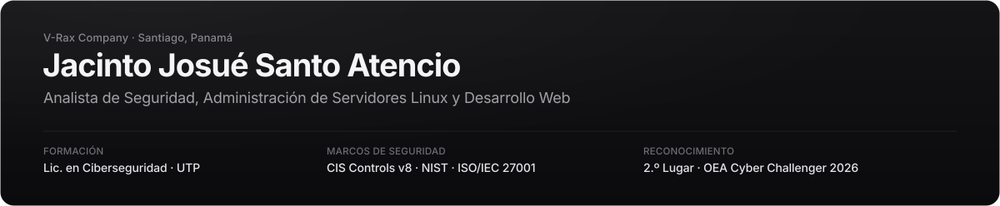

  <a href="https://vraxcompany.com">vraxcompany.com</a>
  &nbsp;·&nbsp;
  <a href="https://www.linkedin.com/in/jacintosanto">linkedin.com/in/jacintosanto</a>
  &nbsp;·&nbsp;
  <a href="mailto:jacintoanew@gmail.com">jacintoanew@gmail.com</a>

Estudiante de **Licenciatura en Ciberseguridad** en la Universidad Tecnológica de Panamá (UTP) y **Analista de Seguridad**. Trabajo en el endurecimiento (*hardening*) de servidores Linux y plataformas web, evaluación de vulnerabilidades bajo los marcos **CIS Controls v8**, **NIST** e **ISO/IEC 27001**, administración de infraestructura virtualizada con **Proxmox** y desarrollo de software.

---

### Proyectos y Laboratorios

| Repositorio | Enfoque | Resumen |
| :--- | :--- | :--- |
| [**linux-server-hardening**](https://github.com/jacintoanew-pixel/linux-server-hardening) | SecOps & Hardening | Caso de estudio sobre Ubuntu 24.04 LTS: matriz de auditoría de 33 controles (`SEC-01`..`SEC-33`), pentest de caja negra, mitigación de CVEs en vivo y script de verificación en Bash. |
| [**aquaguard**](https://github.com/jacintoanew-pixel/aquaguard) | IoT & Telemetría | Prototipo de monitoreo de calidad de agua (pH, TDS y turbidez) de bajo costo para acueductos rurales en la región de Azuero. |
| [**utp-cloud**](https://github.com/jacintoanew-pixel/utp-cloud) | Almacenamiento Web | Plataforma autoalojada en PHP 8 y SQLite (WAL) con autenticación 2FA TOTP (RFC 6238), enlaces firmados con expiración y aislamiento por usuario. |
| [**numa**](https://github.com/jacintoanew-pixel/numa) | Desarrollo Full-Stack | Aplicación web de finanzas personales construida con Next.js 15, TypeScript, Prisma, PostgreSQL y 2FA. |
| [**telegram-downloader-bot**](https://github.com/jacintoanew-pixel/telegram-downloader-bot) | Automatización Python | Servicio asíncrono en Python 3.12 con cola de concurrencia, validación de dominios contra SSRF e integración con `yt-dlp` y `FFmpeg`. |

---

### Experiencia y Reconocimientos

- **Analista de Seguridad · SprayFoam CM** *(2025 – 2026)* — Endurecimiento de plataforma web corporativa, aplicación de controles CIS v8 / NIST / ISO 27001, reportes de vulnerabilidades y análisis de incidentes y correos contra phishing.
- **Desarrollo de Software e Infraestructura · Independiente** — Administración de servidores Linux y Windows Server, virtualización en Proxmox VE, configuración de redes y automatización de servicios.
- **2.º Lugar · OEA Cyber Challenger 2026** — Competencia de ciberseguridad.
- **7.º Lugar · Hackathon Copa Airlines 2026** — Desarrollo y resolución técnica.
- **Investigación Académica (COICIT 2025 / UTP)** — Artículos sobre *Monitoreo de Calidad de Agua con IoT (AquaGuard)* y *Deepfakes y riesgos en ciberseguridad*.

---

### Áreas Técnicas

- **Seguridad:** Hardening de sistemas Linux, CIS Controls v8, NIST, ISO/IEC 27001, análisis de vulnerabilidades, respuesta a incidentes, OSINT, OpenSSH, Fail2ban, UFW, Auditd, Cloudflare Access & Zero Trust.
- **Infraestructura y Redes:** Ubuntu Server / Debian, Proxmox VE, Windows Server, Active Directory, Nginx, segmentación con VLANs, VPN, TCP/IP, IPv6, DNS, DHCP y fibra óptica.
- **Desarrollo y Datos:** Python, Bash, TypeScript / Next.js, PHP 8, C++, HTML/CSS, PostgreSQL, Microsoft SQL Server 2022, SQLite, APIs REST y automatización con n8n.

---

### Certificaciones

- **Google:** Foundations of Cybersecurity · Cloud Digital Leader (Google Cloud) · Certificado Profesional de IA · Google AI Essentials
- **Cisco / UTP:** Introduction to Cybersecurity · Networking Basics · Introducción a la Ciencia de Datos · Introducción a IoT y Transformación Digital · English for IT · IT Customer Support & Hardware Basics
